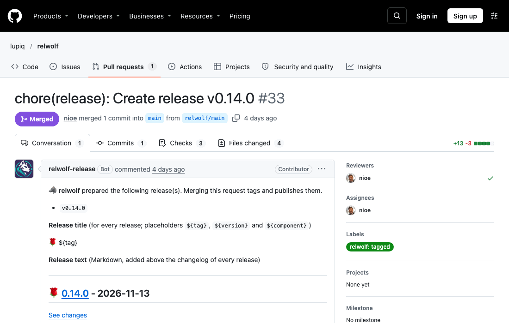
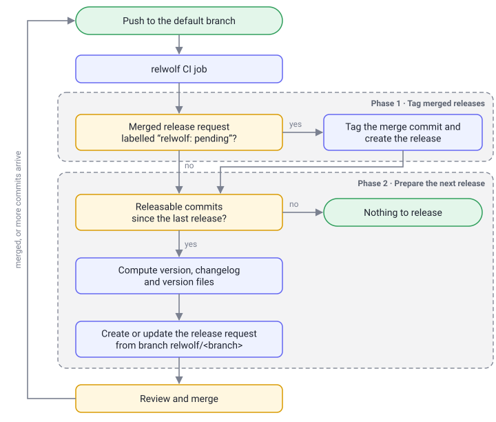

<p align="center">
  
</p>

# relwolf

**Releases, without the release hassle.**

Automate your releases with Conventional Commits. Review every change before it ships.

[](https://github.com/lupiq/relwolf/actions/workflows/ci.yml)
[](https://github.com/lupiq/relwolf/actions/workflows/e2e.yml)
[](https://codecov.io/gh/lupiq/relwolf)
[](https://github.com/lupiq/relwolf/releases/latest)
[](LICENSE)
[](https://github.com/lupiq/relwolf/pkgs/container/relwolf)
[](https://github.com/marketplace/actions/relwolf-release-bot)
[](https://relwolf.lupiq.io)

<p align="center">
  
</p>

relwolf is a release bot for **GitLab** and **GitHub**. It runs as a single CI job, works out the next
[SemVer](https://semver.org/) version from your [Conventional Commits](https://www.conventionalcommits.org/) and opens a
release merge request with the changelog and the updated version files. When you merge it, relwolf tags the commit and
publishes the release.

📖 **Documentation: [relwolf.lupiq.io](https://relwolf.lupiq.io)**

## Why relwolf?

- **Review before release.** Nothing is published until a human merges the release request. You can edit the release
  title and text in its description first.
- **GitLab and GitHub.** The same workflow on gitlab.com, self-managed GitLab, github.com and GitHub Enterprise.
- **One CI job.** No daemon, no webhooks, no database. The release request itself stores the state.
- **Your changelog, your format.** Changelogs are rendered by [git-cliff](https://git-cliff.org), so a `cliff.toml`
  controls grouping, templates and links.
- **Your version files stay in sync.** Updaters for `package.json`, `pom.xml`, Gradle, `pyproject.toml`, `Cargo.toml`,
  .NET, Helm, JSON/YAML/TOML and any text file keep formatting and comments intact.
- **Monorepos.** Independent or linked versions, one release request or one per package.
- **Changesets, if you prefer.** Set `strategy: changesets` and let [Changesets](https://changesets.dev) decide versions
  and changelogs.

## Who is it for?

relwolf fits you if:

- you host on **GitLab** (gitlab.com or self-managed) and want release automation that works the same as on GitHub,
- you want a **human to approve every release** by merging a release request,
- you want **control over the changelog** through git-cliff templates,
- you release a **monorepo** or keep versions in several files and ecosystems,
- you already write **Conventional Commits** or are happy to start.

It is probably not the right tool if you need a fully hands-off pipeline that publishes on every merge, or if you do
not want to follow Conventional Commits and do not use Changesets.

## Quick start

relwolf needs squash merging, the full git history and an access token stored as `RELWOLF_TOKEN`.

### GitHub Actions

Allow squash merging only in the repository settings, then add `.github/workflows/release.yml`:

```yaml
name: Release
on:
  push:
    branches: [main]
concurrency:
  group: release
permissions:
  contents: write
  pull-requests: write
jobs:
  relwolf:
    runs-on: ubuntu-latest # Linux runners only
    steps:
      - uses: actions/checkout@v7
        with:
          fetch-depth: 0 # relwolf needs the full history and all tags
      - uses: lupiq/relwolf@v0 # x-relwolf-major
        with:
          token: ${{ secrets.RELWOLF_TOKEN }}
```

A personal access token or GitHub App token is recommended: events created with the built-in `GITHUB_TOKEN` do not
trigger other workflows, so CI would not run on the release pull request. See the
[GitHub guide](https://relwolf.lupiq.io/guide/github) for all token options.

### GitLab CI

Set the merge method to _Fast-forward merge_ with _Squash_, create a personal or project access token with the `api`
scope (role Developer or higher) and add it as a masked CI/CD variable `RELWOLF_TOKEN`. Then add to `.gitlab-ci.yml`:

```yaml
relwolf:
  image: ghcr.io/lupiq/relwolf:0 # x-relwolf-major
  stage: release # add it to your `stages:` or use an existing stage
  resource_group: relwolf
  variables:
    GIT_DEPTH: 0 # relwolf needs the full history and all tags
  rules:
    - if: $CI_COMMIT_BRANCH == $CI_DEFAULT_BRANCH
  script:
    - relwolf
```

More details: [GitLab guide](https://relwolf.lupiq.io/guide/gitlab).

## How it works

<p align="center">
  <picture>
    <source media="(prefers-color-scheme: dark)" srcset="docs/public/img/relwolf-flow-dark.svg" />
    
  </picture>
</p>

Every run has two phases:

1. **Tag merged releases.** Merged release requests labelled `relwolf: pending` get their tag on the merge commit and a
   release whose notes are the changelog entry.
2. **Prepare the next release.** relwolf analyses the commits since the last release. If something is releasable, it
   generates the changelog entry, updates the version files and creates or updates the release request from the branch
   `relwolf/<branch>`.

```text
feat: Add search        → release request "Create release v0.1.0" opened
fix: Fix typo               → release request updated (still v0.1.0, changelog has both)
(release request merged) → tag v0.1.0 + release created
fix: Fix crash on start     → release request "Create release v0.1.1" opened
```

Git is used read-only; every write (release commit, request, labels, tags, releases) goes through the GitLab or GitHub
API. Every step is idempotent, so a failed job can simply be re-run. See
[How it works](https://relwolf.lupiq.io/guide/how-it-works).

### Example

relwolf releases itself this way. The release request
[`chore(release): Create release v0.14.0`](https://github.com/lupiq/relwolf/pull/33) produced this changelog entry:

```markdown
## 🌹 [0.14.0](https://github.com/lupiq/relwolf/releases/tag/v0.14.0) - 2026-11-13

### 🚀 Features

- Add possibility to use Changesets instead of conventional commits ([9335f86](https://github.com/lupiq/relwolf/commit/9335f86…))
```

The emoji, the heading and the layout come from the repository's own `cliff.toml` and `release-emoji: true`.

## Version rules

| Commit                                   | Bump  |
| ---------------------------------------- | ----- |
| `feat!:`, `fix(x)!:`, `BREAKING CHANGE:` | major |
| `feat:`                                  | minor |
| `fix:`                                   | patch |
| everything else                          | none  |

- Which types release is configurable with `patch-types` and `minor-types`; `exclude-paths` ignores paths.
- Before `1.0.0`, breaking changes bump the minor version (`bump-minor-pre-major`).
- Reverted commits do not count and do not appear in the changelog.
- [Pre-releases](https://relwolf.lupiq.io/guide/pre-releases) such as `1.3.0-beta.1` via `prerelease: beta`.
- Force a version, e.g. `1.0.0`, with `RELWOLF_RELEASE_AS` or the action input `release-as`, without an empty commit.
  See [Controlling the next version](https://relwolf.lupiq.io/guide/release-as).

## Configuration

`relwolf.yaml` in the repository root is optional. Without it relwolf releases a single root package and updates no
files. There are no CLI flags; secrets and CI context come from environment variables. Unknown keys are rejected, and a
[JSON schema](https://relwolf.lupiq.io/schema.json) provides editor completion. A `cliff.toml` is optional as well:
without one, git-cliff's built-in default produces the changelog.

```yaml
# yaml-language-server: $schema=https://relwolf.lupiq.io/schema.json
patch-types: [fix, build]
packages:
  '.':
    updaters:
      - type: package-json
```

### Changesets

Prefer change files over commit messages? Set `strategy: changesets` and [Changesets](https://changesets.dev) decides
versions and changelogs, while relwolf still handles the release request, tags and releases. See
[Changesets](https://relwolf.lupiq.io/configuration/changesets).

```yaml
strategy: changesets
```

### Monorepos

```yaml
packages:
  '.':
    updaters: [{type: package-json}]
  services/api:
    component: api # tags: api-v1.2.3
    updaters:
      - type: pom-xml
```

Only commits touching a package's path count for it. Use `linked-versions` for a shared version, `linked-tags: single`
for one tag and release per group and `separate-pull-requests` for one release request per package. See
[Monorepos](https://relwolf.lupiq.io/configuration/monorepos).

### Updaters

`package-json`, `pom-xml`, `gradle`, `pyproject`, `cargo`, `dotnet`, `helm`, `json`, `yaml`, `toml` and `generic`.
Lockfiles that repeat the project's own version (`package-lock.json`, `Cargo.lock`) are updated together with the
manifest. Any other file works with a marker comment at the end of the line that holds the version, for example
`x-relwolf-version` in a YAML comment next to `tag: 1.2.3`.

`x-relwolf-minor` and `x-relwolf-major` update floating references such as `@v1`. In monorepos, component markers such
as `x-relwolf-version:api` keep several versions in one file. See
[Updaters](https://relwolf.lupiq.io/configuration/updaters).

### More options

Tag format, release names, labels, branch prefix, draft requests, assignees, reviewers, request title and body, a
`pre-commit-script` and more: [relwolf.yaml reference](https://relwolf.lupiq.io/configuration/relwolf-yaml).

## relwolf and release-please

relwolf follows the workflow of Google's [release-please](https://github.com/googleapis/release-please): a release
request collects the changes, merging it creates the tag and release. release-please is excellent, but it exists for
GitHub only. relwolf brings the same review-first workflow to **GitLab** and runs equally on GitHub.

|                   | relwolf                                                                                                                                                                     | release-please                                                                                                                       |
| ----------------- | --------------------------------------------------------------------------------------------------------------------------------------------------------------------------- | ------------------------------------------------------------------------------------------------------------------------------------ |
| Platforms         | GitLab (gitlab.com and self-managed) and GitHub (github.com and Enterprise)                                                                                                 | GitHub only                                                                                                                          |
| Changelog         | Rendered by git-cliff. A `cliff.toml` controls grouping, templates, links and any other part of the format; `rewrite-changelog` regenerates the files after a config change | Sections per commit type (`changelog-sections`) and the notes type `default` or `github`; custom templates only through the code API |
| Revert commits    | `Revert "feat: Add search"` cancels the original commit and both stay out of the changelog                                                                                  | Listed in a `Reverts` section                                                                                                        |
| Forcing a version | `RELWOLF_RELEASE_AS` at runtime (pipeline variable or action input), stored in the release request, per component                                                           | `Release-As:` commit footer or `release-as` in the config file                                                                       |
| Strategies        | Conventional Commits or Changesets (`strategy: changesets`)                                                                                                                 | Conventional Commits                                                                                                                 |
| Custom steps      | `pre-commit-script` modifies any file before the release commit                                                                                                             | No equivalent in its documentation                                                                                                   |
| Configuration     | One `relwolf.yaml` with a JSON schema; no CLI flags                                                                                                                         | JSON config and manifest files, CLI flags                                                                                            |

See the [full comparison](https://relwolf.lupiq.io/guide/comparison) in the documentation.

Like [semantic-release](https://github.com/semantic-release/semantic-release), relwolf derives versions from commit
messages. In relwolf, every release passes through a reviewable merge request before anything is tagged or published.

## Adopting relwolf in an existing project

Existing tags and changelogs can be kept. See [Migrating existing changelogs](https://relwolf.lupiq.io/guide/migrating)
for generating per-module changelogs with git-cliff, adding component tags and `bootstrap-sha`.

## Good to know

- Supported platforms are GitLab and GitHub. Other platforms need a new implementation of the `Provider` interface.
- relwolf is distributed as a Docker image (`ghcr.io/lupiq/relwolf`, linux/amd64 and linux/arm64) and as a GitHub Action
  (Linux runners only). It is not published to npm.
- It needs a full clone; shallow clones abort with an error. Without the Docker image, Node.js 26 or newer is required.
- Release requests are only tagged if they come from relwolf's own release branch in the same project. Labelled requests
  from forks or other branches are skipped.
- With `strategy: changesets`, `RELWOLF_RELEASE_AS` is not supported.
- Squash merging is required. release-please also supports merge commits.
- release-please goes further in some areas: it has built-in release types for many ecosystems, workspace plugins
  that bump dependants (Node, Cargo, Maven), a `patch` marker and start/end marker blocks, and JSONPath and XPath
  updaters. relwolf covers dependants through the Changesets strategy and uses dotted key paths without array indices.

Having trouble? See [Troubleshooting](https://relwolf.lupiq.io/reference/troubleshooting).

## Contributing

Contributions are welcome. Development setup, scripts and conventions are described in
[CONTRIBUTING.md](CONTRIBUTING.md); design decisions and maintainer notes are in [AGENTS.md](AGENTS.md). Security issues:
see [SECURITY.md](SECURITY.md).

## License

relwolf is developed by [lupiq](https://lupiq.com) and released under the [MIT License](LICENSE).
